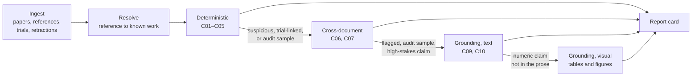

# Sentinel — Project Document

**Repository:** `Arshajindal/sentinel-evidence` · **Python package:** `sentinel`
**Plan:** five phases, about fifteen weeks, solo build
**Purpose of this file:** the single reference for building every phase

---

## 0. How to use this document

**Who reads it.** You and Claude Code. Before any work, Claude Code reads sections 0–8 (they apply to every phase) and the section for the current phase.

**What wins when documents disagree:**

1. ADRs in `PROGRESS.md`. These record decisions and the reasons behind them.
2. This document, which says what to build and how.
3. Everything else: code comments, old briefs, chat notes.

If this document disagrees with an ADR, the ADR wins, and this document is fixed in the same commit. If a real data source behaves differently from what is written here, the source wins. Stop and flag it instead of forcing the code to match the document.

**What it replaces.** `docs/phase1-brief.md` and the HTML spec (v2). Move both to `docs/archive/` so nobody, human or Claude Code, reads the old versions by accident. `PROGRESS.md` stays as it is and keeps tracking status and decisions.

**How work is split.** Each phase is broken into sessions (section 15). The rule is one session, one unit of work, one commit, and three lines in `PROGRESS.md`.

---

## 1. What Sentinel is

Sentinel audits biomedical research papers at corpus scale, meaning thousands of papers at a time rather than one. For each paper, and each linked clinical trial, it produces a **report card**. The card is a list of findings, and each finding has a severity, a reason a machine can check, and an evidence trail a human can follow.

It answers one kind of question: **do two things that should agree actually agree?** For example:

- a reference against the database of real papers
- a cited paper against the retraction database
- a reported p-value against the test statistic it came from
- a registered trial outcome against the published one
- a citing sentence against what the cited source actually says

**It never decides** whether a medical claim is true, never recommends treatment, and never replaces expert review. That is why building it needs no medical training, and why its output is always for a human to triage.

**Primary user:** systematic review teams. Journal editors and guideline committees are secondary users.

**Why it works as a portfolio project:** it needs production engineering (ingestion, entity resolution, scale, cost control, observability) and real ML engineering (retrieval, model comparison, calibration, class imbalance, distillation, an MLOps loop). One project covers both AI engineering and ML engineering roles.

---

## 2. Ground rules

These apply in every phase. Breaking one requires a new ADR.

1. **No clinical claims and no patient data.** Every input is public metadata, a registry record, or published text.
2. **Strip personal data at ingestion (ADR-018).** ClinicalTrials.gov records name people and include their contact details. Drop those fields in `normalise()`, before anything is written. A test enforces this.
3. **"Could not be verified" is not "fabricated."** A reference that can't be matched may be a book, a thesis, or a badly formatted string. The word "fabricated" never appears in any Sentinel output.
4. **Precision over recall.** A 1% flag rate over 420,000 citations hands humans 4,200 items to review. If a third of those are false alarms, people stop using the tool. When a check can't be made precise, narrow the cases it applies to rather than accept false positives.
5. **Deterministic checks produce zero false positives on clean fixtures.** Zero, not "low." A false positive from a rule-based check is a bug.
6. **Evidence is always recorded, including for clean results.** A "clean" result that doesn't show what was examined can't be audited.
7. **Runs are reproducible.** The same input, config and check versions always give the same findings. `config_hash` identifies a run's settings, and `SENTINEL_RANDOM_SEED` fixes every random choice.
8. **Paper text is untrusted input.** From Phase 2 on, text from papers goes into language models. It is treated as data, never as instructions. Instructions hidden in a paper must not change a verdict.
9. **Aggregate first.** Published results report prevalence and counts. A human reviews any finding that names a specific paper before it is published (open question Q4).

---

## 3. The checks

Twelve checks are defined: seven are committed, two are optional, and three are stretch goals.

**Band** is what kind of check it is. **Phase** is when it gets built. These are different things, and mixing them up caused the old phase-numbering clash.

| ID | Check | What it catches | Band | Phase | Commitment |
|---|---|---|---|---|---|
| C01 | Reference existence | A reference that can't be matched to any real work | Deterministic | 1 | Committed |
| C02 | Retraction status | Citing retracted or disputed work | Deterministic | 1 | Committed |
| C03 | Statistical consistency | A p-value that doesn't match its own test statistic | Deterministic | 1 | Committed |
| C04 | Impossible statistics (GRIM) | A mean that can't come from the stated sample size | Deterministic | 1 | Committed |
| C05 | Results reporting | Trial finished, but results were never posted to the registry | Deterministic | 1 | Committed |
| C06 | Outcome switching | One primary outcome registered, a different one published | Cross-document | 3 | Committed |
| C07 | Duplicate publication | The same cohort published more than once | Cross-document | 3 | Optional |
| C08 | Disclosure mismatch | Declared conflicts of interest disagree with public payment records | Cross-document | — | Stretch |
| C09 | Claim support | The cited source doesn't say what it's cited for | Grounding | 3 | Committed |
| C10 | Spin | The abstract's conclusion overstates the results | Grounding | 5 | Optional |
| C11 | Paper-mill markers | Tortured phrases and template structure | Grounding | — | Stretch |
| C12 | Image integrity | Duplicated or spliced figure panels | Visual | — | Stretch |

**The two that carry the project are C06 and C09.** Both compare two texts for meaning, so they share the same retrieval, entailment models, and evaluation harness. Protect them when time gets tight.

**About C08:** it needs a new data source (public payment records) and requires matching authors to named people. That brings personal data back into the project, so it needs its own ADR before any work starts.

---

## 4. Architecture

### The funnel

Cheap checks run on everything, and only suspicious items move on to the more expensive stages. Each stage costs roughly 10–30× more per item than the one before.



These are design targets for a 10,000-paper run. They are estimates to be measured, not promises.

| Stage | Items | Cost per item | Item moves on when |
|---|---|---|---|
| Deterministic | ~420,000 citations | Local lookup | Unresolvable, retracted, or statistically inconsistent |
| Cross-document | ~40,000 | Embedding plus classifier | Trial-linked or a suspected duplicate |
| Grounding, text | ~15,000 | Retrieval plus entailment | Flagged earlier, picked by the random audit sample, or a high-stakes claim |
| Grounding, visual | ~1,500 | Vision model over pages | A numeric claim is missing from the prose |

The random audit sample matters because without it you never learn what the cheap stages miss. It uses `SENTINEL_RANDOM_SEED`.

### Technology, by phase

| Layer | Choice | Phase | Why |
|---|---|---|---|
| Language | Python 3.11+ | 1 | |
| Database | PostgreSQL 15+ with `pg_trgm` | 1 | One system for records, fuzzy matching, and later vectors |
| Database access | SQLAlchemy **Core** (no ORM) and Alembic (ADR-004) | 1 | Explicit SQL, and every schema change is a migration |
| Validation | Pydantic v2 and pydantic-settings | 1 | Nothing unvalidated reaches the database |
| HTTP | httpx and tenacity | 1 | Retries on 429 and 5xx responses only |
| CLI | typer | 1 | |
| Logging | structlog, JSON output | 1 | Cost and latency are logged from day one |
| Statistics | scipy | 1 | p-value recomputation |
| Data frames | polars | 1 | |
| Vectors | pgvector with HNSW (ADR-003) | 2 | Hybrid search is a join, not a second system |
| Retrieval | BM25 plus MedCPT dense retrieval, reciprocal rank fusion, cross-encoder rerank | 2 | Lexical-plus-dense fusion is the proven setup for biomedical retrieval |
| Embedding serving | Text Embeddings Inference (container) | 2 | Runs locally and works on CPU |
| LLM access | LiteLLM router | 2 | Fallback chains and per-request cost accounting |
| Experiment tracking | MLflow, self-hosted | 2 | Runs, ablations, and the model registry |
| Classical ML | LightGBM or XGBoost, plus SHAP | 2 | The honest metadata-only baseline |
| Training | PyTorch, Transformers, PEFT | 3 | Encoder-scale fine-tuning and distillation |
| Orchestration | LangGraph with a Postgres checkpointer | 4 | Runs survive a crash and resume, with a pause for human review |
| Tracing | Langfuse, self-hosted | 4 | Per-stage traces, token counts, latency |
| Evaluation in CI | pytest fixtures, Ragas, promptfoo | 4 | A regression past the threshold fails the build |
| Service | FastAPI and Docker Compose | 5 | A demo endpoint and one-command setup |
| Integration | MCP server | 5 | Lets desktop agents query the audited corpus |

**Deliberately not used:** managed vector databases, Kubernetes, Airflow, dbt, distributed training, and frontend frameworks. Each would cost a week that doesn't exist. Being able to explain when a managed vector store *would* win (many tenants, billions of vectors, outsourced operations) matters more than using one.

---

## 5. Data sources

All sources are public and free. Every source that offers a "polite pool" gets the contact email and user agent from config, because that raises rate limits.

**Confirm every endpoint against the live docs before coding against it.** These services change their paths. Test with real endpoint paths, not bare base URLs.

| Source | How Sentinel gets it at current scale | Used for | Phase |
|---|---|---|---|
| Europe PMC | REST API | Corpus selection, paper metadata, structured reference lists, open-access full text | 1 (full text in 2) |
| Crossref | REST API | DOI lookups, candidate search for unmatched references, deposited reference lists | 1 |
| OpenAlex | REST API | Work metadata, a second candidate source, the citation graph | 1 |
| doi.org handle API | REST, by DOI | Confirms whether a DOI exists at any registration agency, not just Crossref | 1 |
| Retraction Watch | CSV from Crossref's GitLab repository | Retraction and expression-of-concern notices | 1 |
| ClinicalTrials.gov | API v2, one study at a time (`/api/v2/studies/{nctId}`) | Trial records and current outcomes | 1 |
| ClinicalTrials.gov history | **Not in the public v2 API** (see Q5) | Earlier versions of registered outcomes, for C06 | 3 |

**API, not bulk snapshots, at this scale (ADR-020).** At 1,000 papers, fetching what you need is simpler than downloading Crossref and OpenAlex in full. Fetched records are stored in `paper`, so each lookup is paid for only once. Revisit this for the 10,000-paper run in Phase 5 if API throughput becomes the bottleneck.

**ClinicalTrials.gov, one study at a time first.** The bulk download contains every study in the registry, around 600,000 records, which is far more than the roughly 1,000 linked trials need. Per-study fetching is the default. The bulk zip (ADR-019) is kept for the 10,000-paper run or for registry-wide statistics. *This changes how ADR-019 is applied, so record it in a new ADR that amends ADR-019.*

**Retraction Watch:** get it with `git clone https://gitlab.com/crossref/retraction-watch-data` and point `SENTINEL_RETRACTION_WATCH_CSV_PATH` at the CSV inside the cloned folder. The old Crossref Labs API link is no longer maintained and returns stale data, so don't use it. `data/` is gitignored.

**Personal data (ADR-018, ADR-025):** drop every path in `SENTINEL_TRIAL_DROP_PATHS` (central contacts, overall officials, per-location contacts, the responsible party, and the results point of contact) before writing `trial.raw`. Keep only institutional fields: sponsor and sponsor class, country-level locations, dates, status, enrolment, and outcomes.

---

## 6. Repository layout

Phase 1 creates the core. Later phases add folders, and nothing built in Phase 1 should need to move.

```
sentinel-evidence/
  CLAUDE.md                 # short rules Claude Code reads automatically
  README.md
  PROGRESS.md               # status and ADRs (source of truth for decisions)
  pyproject.toml
  alembic.ini
  .env.example              # canonical list of every config variable
  docs/
    sentinel-project.md     # this document
    archive/                # superseded briefs and specs
  migrations/
  src/sentinel/
    config.py               # pydantic-settings, SENTINEL_ prefix (ADR-022)
    db.py                   # SQLAlchemy Core engine and pool
    models.py               # Core Table definitions
    schemas.py              # Pydantic models for all structured data
    ingest/                 # Phase 1
      base.py               # Harvester and LookupClient base classes
      europepmc.py
      crossref.py
      openalex.py
      doi_handle.py
      retraction_watch.py
      clinicaltrials.py
    parse/                  # Phase 1
      references.py         # reference string -> structured fields
      statistics.py         # find reported test statistics in text
    resolve/                # Phase 1
      normalize.py          # DOI, title and author normalisation
      candidates.py         # fetch candidate works from Crossref and OpenAlex
      cascade.py            # staged matching
    checks/                 # Phase 1, grows in Phases 3 and 5
      base.py               # Check base class
      context.py            # PaperContext, TrialContext
      c01_existence.py
      c02_retraction.py
      c03_statcheck.py
      c04_grim.py
      c05_results_reporting.py
      registry.py           # check id -> class, versioned
    report/                 # Phase 1
      card.py
      export.py             # JSON and CSV
    fulltext/               # Phase 2: JATS parsing, passages, citation contexts
    retrieve/               # Phase 2: BM25, dense, fusion, rerank
    extract/                # Phase 2: claim skeletons
    ml/                     # Phases 2–4: baseline, judges, calibration, distillation
    eval/                   # Phase 2 onward: corruption generator, harness, metrics
    orchestrate/            # Phase 4: LangGraph graph and nodes
    mlops/                  # Phase 4: registry glue, drift, retraining trigger
    service/                # Phase 5: FastAPI
    mcp/                    # Phase 5: MCP server
    cli.py                  # typer entry point
  tests/
    fixtures/               # real papers and trials with hand-checked expected findings
    test_*.py
  docker/                   # Phases 4–5: compose files for Postgres, MLflow, Langfuse, TEI
```

The ML package is named `ml/`, not `models/`, so it doesn't clash with `models.py`, which holds the table definitions.

---

## 7. Configuration

All config comes from environment variables with the `SENTINEL_` prefix, loaded by pydantic-settings. `.env.example` is the canonical list, and `.env` is gitignored.

**ADR-022, in short:** operational settings (batch sizes, timeouts, pool sizes, log level) have defaults. Anything that can change a finding (thresholds, enabled checks, resolution parameters, seed, contact identity, privacy flags) has **no default**, and startup fails if it's missing. A test checks this.

**`config_hash`** is computed only over the settings that can change a finding. Changing a batch size doesn't change a run's identity, but changing a threshold does. Every `check_run` row stores the hash.

**Phase additions:** each phase adds its variables to `.env.example` in the same commit as the code that reads them, with a comment naming the ADR or section that governs them. Model names, endpoints and thresholds for Phases 2–5 can change findings, so none of them get defaults.

---

## 8. Database schema (Phase 1)

This is the initial migration. It includes two fixes to the old brief:

- `check_run` is defined before `finding`. In the old order the migration failed.
- A finding is about **either a paper or a trial**. C05 runs on registry data with no paper involved, so `finding.paper_id` can't be required. Exactly one of `paper_id` and `nct_id` is set.

**If you already ran the initial migration, don't edit it.** Add a second migration that makes `finding.paper_id` nullable and adds `finding.nct_id`, the check constraint, and the index.

Column choices are load-bearing. Flag a disagreement instead of silently changing a column.

```sql
CREATE EXTENSION IF NOT EXISTS pg_trgm;

-- A work we know about, from any source.
CREATE TABLE paper (
    id              BIGSERIAL PRIMARY KEY,
    doi             TEXT UNIQUE,              -- normalised: lowercase, no prefix
    pmid            TEXT UNIQUE,
    pmcid           TEXT UNIQUE,
    title           TEXT NOT NULL,
    title_norm      TEXT NOT NULL,            -- for fuzzy matching
    container       TEXT,                     -- journal or venue name
    year            SMALLINT,
    first_author    TEXT,                     -- surname only, normalised
    authors         JSONB,
    source          TEXT NOT NULL,            -- europepmc|crossref|openalex|pubmed
    is_oa           BOOLEAN,
    license         TEXT,
    fulltext_status TEXT NOT NULL DEFAULT 'none',  -- none|abstract|full
    raw             JSONB,
    ingested_at     TIMESTAMPTZ NOT NULL DEFAULT now(),
    updated_at      TIMESTAMPTZ NOT NULL DEFAULT now()
);
CREATE INDEX paper_title_trgm ON paper USING gin (title_norm gin_trgm_ops);
CREATE INDEX paper_author_year ON paper (first_author, year);

-- One row per entry in a citing paper's bibliography.
CREATE TABLE reference (
    id                  BIGSERIAL PRIMARY KEY,
    citing_paper_id     BIGINT NOT NULL REFERENCES paper(id) ON DELETE CASCADE,
    ordinal             INT,                  -- position in the bibliography
    raw_string          TEXT,
    parsed_doi          TEXT,
    parsed_title        TEXT,
    parsed_first_author TEXT,
    parsed_year         SMALLINT,
    parsed_container    TEXT,
    resolved_paper_id   BIGINT REFERENCES paper(id),
    resolution_method   TEXT,                 -- winning cascade stage, see 9.5
    resolution_score    REAL,                 -- 0..1
    resolution_status   TEXT NOT NULL DEFAULT 'pending',
                                              -- pending|resolved|unresolved|ambiguous
    resolved_at         TIMESTAMPTZ
);
CREATE INDEX reference_citing ON reference (citing_paper_id);
CREATE INDEX reference_status ON reference (resolution_status);

-- Retraction and concern notices, keyed loosely because sources disagree.
CREATE TABLE retraction_notice (
    id              BIGSERIAL PRIMARY KEY,
    retracted_doi   TEXT,
    retracted_pmid  TEXT,
    notice_doi      TEXT,
    notice_type     TEXT NOT NULL,   -- retraction|correction|expression_of_concern|reinstatement
    notice_date     DATE,
    reason          TEXT,
    source          TEXT NOT NULL,
    source_record_id TEXT,           -- the source's own ID; upsert key (ADR-024)
    raw             JSONB,
    UNIQUE (source, source_record_id)
);
CREATE INDEX retraction_doi ON retraction_notice (retracted_doi);
CREATE INDEX retraction_pmid ON retraction_notice (retracted_pmid);

-- Registry record for a clinical trial. Personal fields stripped (ADR-018).
CREATE TABLE trial (
    nct_id                  TEXT PRIMARY KEY,
    brief_title             TEXT,
    overall_status          TEXT,
    study_type              TEXT,
    phase                   TEXT,
    enrollment              INT,
    start_date              DATE,
    primary_completion_date DATE,
    completion_date         DATE,
    results_first_posted    DATE,
    lead_sponsor            TEXT,
    sponsor_class           TEXT,
    raw                     JSONB,
    ingested_at             TIMESTAMPTZ NOT NULL DEFAULT now()
);

-- Outcome definitions, versioned.
-- version_no = 0 is the current record as last fetched (Phase 1).
-- version_no 1..n are registry history versions, added in Phase 3 (see Q5).
CREATE TABLE trial_outcome (
    id              BIGSERIAL PRIMARY KEY,
    nct_id          TEXT NOT NULL REFERENCES trial(nct_id) ON DELETE CASCADE,
    version_no      INT NOT NULL,
    version_date    DATE,
    outcome_type    TEXT NOT NULL,   -- primary|secondary|other
    measure         TEXT NOT NULL,
    description     TEXT,
    time_frame      TEXT,
    UNIQUE (nct_id, version_no, outcome_type, measure)
);
CREATE INDEX trial_outcome_nct ON trial_outcome (nct_id);

CREATE TABLE paper_trial_link (
    paper_id    BIGINT NOT NULL REFERENCES paper(id) ON DELETE CASCADE,
    nct_id      TEXT NOT NULL REFERENCES trial(nct_id) ON DELETE CASCADE,
    link_source TEXT NOT NULL,   -- registry|fulltext|crossref|europepmc
    confidence  REAL,
    PRIMARY KEY (paper_id, nct_id)
);

-- Every statistical test string found in a paper, with recomputation.
CREATE TABLE stat_test (
    id              BIGSERIAL PRIMARY KEY,
    paper_id        BIGINT NOT NULL REFERENCES paper(id) ON DELETE CASCADE,
    location        TEXT,            -- section or page hint
    raw_string      TEXT NOT NULL,
    test_type       TEXT NOT NULL,   -- t|F|chi2|r|z
    statistic       DOUBLE PRECISION,
    df1             DOUBLE PRECISION,
    df2             DOUBLE PRECISION,
    reported_p      DOUBLE PRECISION,
    reported_p_op   TEXT,            -- '='|'<'|'>'
    computed_p      DOUBLE PRECISION,
    one_tailed_ok   BOOLEAN,         -- consistent if one-tailed is assumed
    inconsistent    BOOLEAN,
    gross           BOOLEAN          -- crosses the .05 decision boundary
);
CREATE INDEX stat_test_paper ON stat_test (paper_id);

-- One row per run of the check suite. Must exist before finding.
CREATE TABLE check_run (
    id           BIGSERIAL PRIMARY KEY,
    started_at   TIMESTAMPTZ NOT NULL DEFAULT now(),
    finished_at  TIMESTAMPTZ,
    corpus_label TEXT,
    config_hash  TEXT NOT NULL,
    checks       TEXT[] NOT NULL,
    counts       JSONB,
    status       TEXT NOT NULL DEFAULT 'running'
);

-- The report card: one row per finding, about a paper OR a trial.
CREATE TABLE finding (
    id          BIGSERIAL PRIMARY KEY,
    paper_id    BIGINT REFERENCES paper(id) ON DELETE CASCADE,
    nct_id      TEXT REFERENCES trial(nct_id) ON DELETE CASCADE,
    run_id      BIGINT NOT NULL REFERENCES check_run(id) ON DELETE CASCADE,
    check_id    TEXT NOT NULL,       -- 'C03'
    check_ver   TEXT NOT NULL,       -- bump when logic changes
    severity    TEXT NOT NULL,       -- info|low|medium|high
    status      TEXT NOT NULL,       -- flagged|clean|not_applicable|insufficient_data
    summary     TEXT NOT NULL,       -- one human-readable line
    evidence    JSONB NOT NULL,      -- structured, check-specific, always populated
    created_at  TIMESTAMPTZ NOT NULL DEFAULT now(),
    CONSTRAINT finding_one_subject CHECK (num_nonnulls(paper_id, nct_id) = 1)
);
CREATE INDEX finding_paper ON finding (paper_id);
CREATE INDEX finding_nct ON finding (nct_id);
CREATE INDEX finding_check ON finding (check_id, status);

CREATE TABLE ingest_watermark (
    source       TEXT PRIMARY KEY,
    cursor       TEXT,
    last_run_at  TIMESTAMPTZ,
    rows_seen    BIGINT NOT NULL DEFAULT 0
);
```

**Migration rules:** `CREATE EXTENSION` goes on the first line of `upgrade()`, and the trigram GIN index is added by hand because autogenerate can't produce it. `downgrade()` drops tables in reverse order and leaves the extension alone. Every migration is tested up, down, up.

**Why these columns:**

- `finding.evidence` is always filled, including for clean results, so every result can be audited.
- `finding.check_ver` lets an improved check produce comparable new rows instead of silently overwriting history.
- A paper's report card includes the trial findings for its linked trials, through `paper_trial_link`. C05 findings are stored once per trial, not repeated for every paper that cites the trial.

---

## 9. Phase 1 — Data foundation and deterministic checks (weeks 1–3)

**Goal:** a working, useful tool with zero machine learning. This is the credibility floor: even if every later phase underperforms, Phase 1 still produces real findings on real papers.

### 9.1 Not in Phase 1

Building these now would distort the schema.

- No embeddings, no vector search, no `pgvector` extension
- No LLM calls of any kind
- No LangGraph or other agent framework
- No web UI. CLI only.
- No full-text PDF parsing beyond what the deterministic checks need
- No outcome comparison logic (Phase 3), although trial data **is** ingested now
- No authentication and no multi-user features

If a task seems to need one of these, stop and flag it instead of improvising.

### 9.2 The corpus (ADR-021)

The working corpus is 1,000 PMC open-access papers that carry NCT numbers, from any disease area. Select them through Europe PMC search (open-access filter plus an NCT accession filter; confirm the exact query syntax first), and sample with `SENTINEL_RANDOM_SEED`. Record the query, the seed, and the date of selection in `PROGRESS.md`, and store the corpus label in `check_run.corpus_label`.

This corpus is deliberately **not representative**, so never compare its flag rates with published prevalence figures. That comparison uses a separate validation set in Phase 5.

### 9.3 Getting data in

There are two kinds of source code.

**Harvesters** walk through a source and save everything they find. They can resume where they stopped. Examples: the Retraction Watch CSV, the Europe PMC corpus walk, and a batch of trials.

```python
class Harvester(ABC):
    source: str

    @abstractmethod
    def fetch(self, cursor: str | None) -> Iterator[tuple[dict, str | None]]:
        """Yield (raw_record, next_cursor). Must resume from cursor."""

    @abstractmethod
    def normalise(self, raw: dict) -> BaseModel:
        """Raw payload -> validated Pydantic model. Never write unvalidated data."""
```

**Lookup clients** fetch one thing on demand, by ID or by search query. Examples: a Crossref lookup by DOI, an OpenAlex title search, a doi.org handle check, and a ClinicalTrials.gov study by NCT ID. Every result is upserted into `paper` (or `trial`) and the raw response is kept, so no lookup is paid for twice.

Requirements for both kinds:

- **Rate limit** with a token bucket, configurable per source
- **Retry** with exponential backoff through `tenacity`, on 429 and 5xx responses only
- **Idempotent upserts** on the natural key: never delete, mark superseded instead
- **Structured logs** per batch: records seen, written, skipped, and failed
- Harvesters only: **resumable** from `ingest_watermark.cursor`, so a run killed at record 40,000 restarts there
- ClinicalTrials.gov only: apply the **ADR-018 drop paths** in `normalise()`

### 9.4 Reference parsing

The input is either a structured reference list (from Europe PMC or Crossref) or an unstructured bibliography string.

Structured lists are simple: map the fields and move on. For unstructured strings, extract the DOI if present, the title, the first author's surname, the year, and the container (journal). The parser is rule-based. Don't reach for a model.

- **DOI:** regex for `10.\d{4,9}/\S+`, then normalise
- **Year:** a four-digit number between 1900 and next year, preferring one next to parentheses
- **Author:** the leading surname pattern before initials or "et al"
- **Title:** the longest segment between delimiters that isn't the container

Some strings won't parse, and that's expected. Record the `parsed_*` fields as NULL and let resolution handle it. **Don't guess.** A wrong parse is worse than a null, because it leads to a confident wrong match downstream.

### 9.5 Entity resolution

Entity resolution means matching each reference to a known work. The cascade runs in stages and stops at the first stage that finds exactly one match.

| Stage | Method | Score | Notes |
|---|---|---|---|
| 1 | Normalised DOI, exact | 1.00 | Lowercase it, strip `https://doi.org/`, strip trailing punctuation. If the DOI isn't in `paper` yet, look it up (Crossref, then OpenAlex). |
| 2 | PMID, exact | 1.00 | |
| 3 | Normalised title, exact | 0.95 | Unicode NFKD, lowercase, punctuation and whitespace stripped |
| 4 | Title trigram ≥ 0.85 **and** first author matches **and** year within ±1 | 0.70–0.90 | `pg_trgm` similarity, with the score scaled by similarity |
| 5 | Title trigram ≥ 0.92 alone | 0.60 | Weak, so mark it for review |

**Candidate fetch, which follows from ADR-020:** because Crossref and OpenAlex aren't stored locally in full, stages 3–5 need candidates first. When a reference has no local match, query Crossref's bibliographic search and OpenAlex's title search with the parsed title, author and year. Upsert the top results into `paper`, then run stages 3–5 locally. Log the number of candidate fetches as a cost metric.

Record the winning stage in `resolution_method`. If two or more candidates tie at a stage, set the status to `ambiguous` and stop. Don't pick one.

**The distinction that protects the project's credibility: unresolved is not fabricated.** A reference can fail every stage because it's a book, a conference abstract, a regional journal that isn't indexed, a personal communication, or just badly formatted. C01 separates three cases:

- `unresolved_nonjournal`: the parsed fields suggest a book, thesis, website, or personal communication. This is **not** a finding.
- `unresolved_unparseable`: the string couldn't be parsed well enough to attempt resolution. This is reported as `insufficient_data`, not as a flag.
- `unresolved_journal_like`: it parsed as a journal article with a plausible title, author and year, and still matched nothing. **This is the only case that becomes a flag**, at `medium` severity and worded "could not be verified."

When a reference has a DOI that isn't in Crossref, ask the doi.org handle API before flagging it. The DOI may be registered with another agency (DataCite, for example). If doi.org knows the DOI, the reference exists.

### 9.6 The check interface

```python
class Check(ABC):
    check_id: str                         # 'C03'
    check_ver: str                        # '1.0.0', bumped on any logic change
    subject: Literal["paper", "trial"]

    @abstractmethod
    def run(self, ctx: PaperContext | TrialContext) -> list[Finding]: ...
```

Checks are pure: the same input and version always give the same findings. There are no network calls inside `run()`, because all data is loaded into the context first. `PaperContext` carries the paper, its references with their resolution results, linked trials, and statistical tests. `TrialContext` carries the trial and its outcomes. Later phases add fields to these contexts without changing the interface.

### 9.7 The five checks

#### C01 — Reference existence

For each reference, run the cascade and classify the result as in 9.5. Only `unresolved_journal_like` becomes a flag, at `medium` severity, with the summary "could not be verified."

Evidence: the raw string, the parsed fields, every stage attempted, near-misses with their scores, and the doi.org check result when one was made. A reviewer must be able to see why the match failed.

#### C02 — Retraction and concern status

For each resolved reference, look up `retraction_notice` by DOI and by PMID.

A paper can sit in press for six to twelve months, so a paper published shortly after a retraction notice may have had no way of knowing about it. Severity therefore depends on timing, in three bands.

Let `gap = citing_paper.publication_date − notice.notice_date` and `G = SENTINEL_C02_GRACE_MONTHS` (value set in `.env.example`).

| Condition | Severity | Wording |
|---|---|---|
| `gap > G` | `high` | Cited after retraction |
| `0 < gap ≤ G` | `low` | Retracted while this paper was in press |
| `gap ≤ 0` | `low` | Cited before retraction; downstream claims may need review |
| Expression of concern, any timing | `medium` | Concern raised about a cited source |

If the citing paper's publication date is unknown, return `insufficient_data` instead of guessing a band.

Evidence: the notice type and date, the citing paper's publication date, the computed gap, the band applied, and the reason if one is given. The grace window is a precision decision, and changing it moves the headline flag rate.

#### C03 — Statistical consistency

Find the reported null-hypothesis tests in the full text and recompute each p-value from the test statistic and degrees of freedom.

The patterns to match are case-insensitive and tolerant of spacing and Unicode:

```
t(58) = 2.10, p = .03
F(2, 45) = 3.21, p < .05
χ2(1, N = 120) = 4.50, p = .034
r(28) = .45, p < .01
z = 2.10, p = .036
```

Recompute two-tailed unless the paper says otherwise:

- `t` → `2 * scipy.stats.t.sf(abs(stat), df)`
- `F` → `scipy.stats.f.sf(stat, df1, df2)`, which is one-tailed by definition
- `χ²` → `scipy.stats.chi2.sf(stat, df)`
- `r` → convert with `t = r * sqrt(df / (1 - r²))`, then treat as `t`
- `z` → `2 * scipy.stats.norm.sf(abs(stat))`

The comparison rules matter more than the recomputation:

1. **Respect the reported precision.** If the paper prints `p = .03`, any computed value that rounds to `.03` is consistent.
2. **Respect the operator.** `p < .05` is consistent with any computed value below `.05`.
3. **Test the one-tailed version before flagging.** If halving the p-value makes it consistent, set `one_tailed_ok = true` and **don't flag**. Many papers report one-tailed tests without saying so.
4. **Flag `inconsistent`** only when neither assumption makes the numbers agree.
5. **Flag `gross`** when the reported and recomputed values fall on opposite sides of `.05`.

Severity is `low` for inconsistent and `high` for gross.

#### C04 — Impossible statistics (GRIM)

For a mean `M` of `N` items measured on an integer scale, `M × N` must be a whole number. If it isn't, within the rounding implied by the reported decimals, that mean can't come from the stated data.

```
tolerance  = 0.5 * 10^(-decimals)
granular   = round(M * N) / N
consistent = abs(M - granular) <= tolerance + epsilon
```

The check only applies when all of these hold: the measure is integer-valued, `N` is known and under about 100, and the mean is reported to at least two decimal places. Otherwise return `not_applicable` rather than guessing.

Severity is `medium`. When the check applies, its precision is very high, which is exactly why the conditions must be strict.

#### C05 — Results reporting

This is a check on trials. It runs on registry data alone, which makes it the cheapest check in the system and a good end-to-end test.

It applies only to interventional studies, excluding Early Phase 1 and Phase 1. Flag when all of these hold:

- `overall_status` is completed
- `primary_completion_date` is more than `SENTINEL_C05_GRACE_MONTHS` (value set in `.env.example`) months in the past
- `results_first_posted` is null

If `primary_completion_date` is missing, return `insufficient_data`.

Severity is `medium`. The wording is "no results posted on ClinicalTrials.gov N months after primary completion." Never use "non-compliant" or "violation." Whether a trial was legally required to post depends on facts Sentinel can't verify.

Evidence: the dates, months since primary completion, sponsor and sponsor class, phase, study type, and the country-level location list.

### 9.8 CLI

```
sentinel corpus select [--n 1000] [--label NAME]
sentinel ingest <source> [--limit N] [--resume]
sentinel resolve [--batch-size N]
sentinel check [--checks C01,C03] [--corpus LABEL] [--limit N]
sentinel report <paper-id | doi | nct-id> [--format text|json]
sentinel export --run <run-id> --format csv --out PATH
sentinel stats --run <run-id>
```

`report` works out what it was given from the format: `NCT` followed by 8 digits is a trial, anything starting with `10.` is a DOI, and an integer is a paper ID. A paper's card includes findings for its linked trials.

`stats` prints per-check counts, flag rates, cascade stage ratios, and wall time per stage. Build it in from the start, because the cascade ratios are a headline metric and can't be reconstructed later.

### 9.9 Tests

Unit tests are necessary but not sufficient. The fixture tests are the ones that matter.

**Build a fixture set of 30–50 real papers and trials** with hand-checked expected findings, stored as saved JSON in `tests/fixtures/`. Tests never call live APIs. The set must include:

- at least five papers citing retracted work, covering all three C02 timing bands
- at least five papers with known statistical inconsistencies, checked by hand
- at least five papers whose references include books, theses, or personal communications, to confirm C01 doesn't flag them
- at least five completely clean papers, to measure the false-positive rate
- for C05: at least three overdue trials, three trials with posted results, and two trials outside the check's scope (Phase 1, or observational)
- edge cases: Unicode in author names, DOIs with trailing punctuation, references with no year

The suite asserts exact matches on check ID, status, and severity.

**Required rule tests:**

- ADR-018: no dropped path survives into `trial.raw`
- ADR-022: removing a required variable makes startup fail
- Migrations: up, down, up runs cleanly against a real Postgres

**Every false positive found during development becomes a fixture.** That's how the suite turns into a safety net rather than a formality.

### 9.10 Phase 1 is done when

1. `sentinel ingest` runs for every Phase 1 source over the corpus and resumes after being killed.
2. Resolution reaches ≥ 90% resolved on a sample of 1,000 references from papers with structured reference lists.
3. All five checks pass the fixture suite with zero unexpected findings.
4. One paper's report card is produced from a DOI in under five seconds, not counting ingestion.
5. A full 1,000-paper corpus run completes, and `sentinel stats` reports per-check flag rates and cascade ratios.
6. False positives on clean fixtures: zero.
7. The README covers setup, each check, and each check's known limits.

### 9.11 What later phases need from Phase 1

- `paper.fulltext_status` and `paper.license` are filled at ingestion. Adding licence data across a corpus later is painful.
- `trial_outcome` stores the current record as version 0 now. History versions are added in Phase 3 without a schema change.
- `finding.evidence` is JSONB and check-specific, so later checks with richer evidence need no schema change.
- New checks plug into the same `Check` interface and contexts.
- `pgvector` isn't installed yet, but nothing blocks adding it.

---

## 10. Phase 2 — Full text, retrieval, evaluation foundation (weeks 4–6)

**Goal:** build the machinery that C06 and C09 depend on, and the means to measure it. Phase 2 produces no verdicts yet. It produces good retrieval, plus labelled data to test the Phase 3 models against.

### 10.1 What to build

1. **Full-text fetch.** Get Europe PMC JATS XML (the structured XML format journals use) for the corpus papers and for every cited source that is open access. Set `fulltext_status` and `license`. Store full text only for open-access or licensed records. For everything else, keep a pointer and the abstract. **Measure what share of cited sources has full text.** That number caps how much C09 can ever check (Q2).
2. **Passages.** Split the XML by section, then into passages of about 150–300 words with a small overlap. Keep the section label (methods, results, and so on) on each passage.
3. **Citation contexts.** From each in-text citation marker (`<xref ref-type="bibr">`), take the citing sentence plus one sentence on either side, and link it to its `reference` row. This step is deterministic.
4. **Embeddings.** Use the MedCPT article encoder for passages and the MedCPT query encoder for claims (confirm the model names on Hugging Face before use). Serve them with Text Embeddings Inference. Store each vector alongside the name of the model that made it.
5. **Retrieval**, for "given a claim, find the passages in the cited source that bear on it":
   - BM25 keyword search, using a real BM25 implementation such as the `bm25s` library. Postgres's built-in `ts_rank` is not BM25, so don't label it as BM25.
   - Dense search with pgvector HNSW.
   - Reciprocal rank fusion (k = 60), which merges the two ranked lists into one.
   - Cross-encoder rerank of the top 50 (MedCPT cross-encoder), keeping the top 3–5.
6. **Claim skeletons.** From each citation context, extract population, intervention, comparator, outcome, effect size, sample size, and direction into a Pydantic model. Start with an LLM call through LiteLLM, retrying on validation failure, and track the validation failure rate as a metric. Paper text goes into the prompt marked as untrusted data.
7. **Evaluation sets:**
   - **External:** a published, human-labelled claim–evidence dataset, such as SciFact. Check its licence first (Q6).
   - **Synthetic:** a corruption generator that takes supported (claim, source passage) pairs and corrupts them in known ways: swap the source, flip the direction, weaken or strengthen the effect, or change the population. Each item records its corruption type, which makes error analysis possible later.
   - **Retrieval:** claim → correct passage(s), built from the external dataset's rationales and from the generator's source pairs.
8. **Tabular baseline.** Gradient boosting on metadata alone, for example venue, year, reference count, the year gap between citing and cited paper, self-citation, the cited paper's retraction status, and sponsor class. Give it calibrated outputs and SHAP explanations. It predicts the same labels as the Phase 3 models. It is the number the expensive pipeline must beat, and if it comes close, that's a finding to report rather than hide.
9. **MLflow** from the first experiment. Set up the model registry roles listed in `PROGRESS.md`.

### 10.2 Schema additions (first Phase 2 session, sketch to finalise)

```sql
CREATE EXTENSION IF NOT EXISTS vector;

CREATE TABLE passage (
    id          BIGSERIAL PRIMARY KEY,
    paper_id    BIGINT NOT NULL REFERENCES paper(id) ON DELETE CASCADE,
    section     TEXT,              -- abstract|introduction|methods|results|discussion|other
    ordinal     INT NOT NULL,
    text        TEXT NOT NULL,
    embedding   vector(768),
    embed_model TEXT,
    UNIQUE (paper_id, ordinal)
);
CREATE INDEX passage_embedding_hnsw ON passage USING hnsw (embedding vector_cosine_ops);

CREATE TABLE citation_context (
    id           BIGSERIAL PRIMARY KEY,
    reference_id BIGINT NOT NULL REFERENCES reference(id) ON DELETE CASCADE,
    section      TEXT,
    sentence     TEXT NOT NULL,     -- the citing sentence
    context_text TEXT NOT NULL      -- plus one sentence either side
);

CREATE TABLE claim (
    id                  BIGSERIAL PRIMARY KEY,
    citation_context_id BIGINT NOT NULL REFERENCES citation_context(id) ON DELETE CASCADE,
    skeleton            JSONB,      -- population, intervention, comparator, outcome, effect, n, direction
    extractor           TEXT NOT NULL,
    extractor_ver       TEXT NOT NULL,
    valid               BOOLEAN NOT NULL
);

CREATE TABLE eval_item (
    id               BIGSERIAL PRIMARY KEY,
    set_name         TEXT NOT NULL,   -- synthetic|external|holdout
    split            TEXT NOT NULL,   -- train|val|test
    claim_text       TEXT NOT NULL,
    source_paper_id  BIGINT REFERENCES paper(id),
    gold_passage_ids BIGINT[],
    label            TEXT,            -- supported|contradicted|insufficient
    corruption_type  TEXT,            -- NULL unless synthetic
    origin           JSONB            -- provenance, for leakage checks
);
```

Splits are made **by source paper**, never by row. If passages from the same paper end up in both train and test, scores look better than they really are.

### 10.3 Phase 2 is done when

- Cited-source full-text coverage is measured and written in `PROGRESS.md`.
- The four-row retrieval ablation (BM25, dense, fusion, fusion plus rerank) is logged in MLflow, with nDCG@10 and Recall@50.
- The synthetic set exists with a corruption type on every item, and the external set is loaded.
- The claim-extraction validation failure rate is reported.
- The tabular baseline is trained and calibrated, and its SHAP plot is saved.
- Sanity check: fusion plus rerank should beat BM25 by roughly 15–30% on nDCG@10. A much bigger gain usually means test data leaked into the index.

---

## 11. Phase 3 — Cross-document checks and verdict models (weeks 7–9)

**Goal:** C06 and C09 produce calibrated verdicts, with honest numbers on real data.

### 11.1 What to build

1. **A `Judge` interface.** Every verdict model sits behind one interface, so models can be swapped and compared. The C09 labels are `supported`, `contradicted` and `insufficient`. `insufficient` is a real answer, not a failure. There are four contenders:
   - zero-shot NLI (natural language inference), for example a DeBERTa-v3 NLI checkpoint
   - a fine-tuned verdict head on a biomedical encoder
   - an LLM judge, using structured output and a rationale that cites passage IDs
   - an ensemble of the above
   Any new judge can be added in **shadow mode**: it runs and gets logged, but it never affects a finding until it wins on the real holdout set. Jev, discussed earlier, would enter this way if access comes through.
2. **C09 claim support:** citation context → retrieve from the cited source (Phase 2) → judge → finding. A source with only an abstract gets a verdict explicitly labelled "abstract only."
3. **C06 outcome switching:** compare the registered primary outcome(s) with the published primary outcome, extracted from the abstract and methods. The labels are `same`, `changed`, `added`, `dropped` and `unclear`. It uses the same judge machinery plus normalisation of measures and time frames ("12 weeks" against "3 months"). Where the registered version comes from depends on Q5.
4. **Class imbalance:** use precision-recall curves rather than ROC, report precision at a fixed recall, choose the threshold against an explicit cost function, use a cost-sensitive loss, and compare resampling strategies.
5. **Calibration:** reliability diagrams, Platt scaling and isotonic regression, and expected calibration error (ECE) before and after. ECE measures how far the model's confidence is from how often it's actually right. Fit calibration on a split that wasn't used for training or for choosing the threshold.
6. **Real holdout: 200 hand-labelled items,** picked by active learning (the items where judges are least sure or disagree most), labelled against a written guide. Include a `cant_judge` label for cases that need domain expertise. Exclude those from F1, but report how many there were.
7. **C07 duplicate publication (optional):** SPECTER2 document similarity, combined with a shared NCT ID and author overlap.
8. **Basic injection guard:** in every prompt, paper text is wrapped in delimiters and marked as untrusted, and verdicts are read only from the structured output.

### 11.2 Schema additions (sketch to finalise)

```sql
CREATE TABLE verdict (
    id                   BIGSERIAL PRIMARY KEY,
    claim_id             BIGINT REFERENCES claim(id) ON DELETE CASCADE,
    eval_item_id         BIGINT REFERENCES eval_item(id) ON DELETE CASCADE,
    run_id               BIGINT NOT NULL REFERENCES check_run(id) ON DELETE CASCADE,
    judge                TEXT NOT NULL,     -- model id from the registry
    label                TEXT NOT NULL,
    probs                JSONB NOT NULL,    -- raw per-class probabilities
    calibrated_probs     JSONB,
    evidence_passage_ids BIGINT[],
    rationale            TEXT,
    cost_usd             NUMERIC(10,6),
    latency_ms           INT,
    shadow               BOOLEAN NOT NULL DEFAULT false,
    CHECK (num_nonnulls(claim_id, eval_item_id) = 1)
);

CREATE TABLE outcome_comparison (
    id                     BIGSERIAL PRIMARY KEY,
    paper_id               BIGINT NOT NULL REFERENCES paper(id) ON DELETE CASCADE,
    nct_id                 TEXT NOT NULL REFERENCES trial(nct_id) ON DELETE CASCADE,
    registered_outcome_ids BIGINT[] NOT NULL,   -- trial_outcome rows compared
    published_outcome      TEXT NOT NULL,
    label                  TEXT NOT NULL,       -- same|changed|added|dropped|unclear
    judge                  TEXT NOT NULL,
    probs                  JSONB,
    run_id                 BIGINT NOT NULL REFERENCES check_run(id) ON DELETE CASCADE
);

CREATE TABLE human_label (
    id           BIGSERIAL PRIMARY KEY,
    eval_item_id BIGINT NOT NULL REFERENCES eval_item(id) ON DELETE CASCADE,
    labeller     TEXT NOT NULL,
    label        TEXT NOT NULL,   -- supported|contradicted|insufficient|cant_judge
    notes        TEXT,
    created_at   TIMESTAMPTZ NOT NULL DEFAULT now()
);
```

### 11.3 Phase 3 is done when

- A comparison table shows macro F1 for every judge, on both the synthetic set and the real holdout, side by side.
- The gap between synthetic and real results is reported. A drop of 10–25 F1 points is normal.
- ECE before and after calibration is reported, along with the chosen operating threshold and its precision and recall.
- C06 prevalence across corpus trials is reported, with the exact definition used.
- The comparison with the tabular baseline is reported, even if the baseline comes uncomfortably close.

---

## 12. Phase 4 — Distillation, orchestration, MLOps (weeks 10–12)

**Goal:** make the system cheap, observable, and operable.

### 12.1 What to build

1. **Distillation:** the LLM judge labels a large set of unlabelled claim–passage pairs, and a small biomedical encoder (about 100M parameters) is trained on those labels. Report F1 retained against the teacher (the target, set in advance, is at least 85%) and the cost and latency per 1,000 items for both models. That pair of numbers is the headline result.
2. **LangGraph orchestration** of the whole funnel, with a Postgres checkpointer. A corpus run that is killed partway through resumes where it stopped. A human-review interrupt pauses on flagged items above a chosen severity.
3. **Langfuse tracing:** a trace for every stage, with token counts, cost, and p50 and p95 latency.
4. **Eval-gated CI (GitHub Actions):** unit and fixture tests, the migration up-down-up test, and a frozen evaluation set run through promptfoo and Ragas. A regression past the threshold fails the build.
5. **MLOps loop:**
   - MLflow registry with versioned artifacts, plus lineage back to data and `config_hash`
   - drift detection on inputs (claim length, section mix, shift in embedding centroids) and on outputs (flag rate)
   - an automatic retraining trigger
   - a promotion gate: a new model must beat the current one on the real holdout
   - one-command rollback

### 12.2 Phase 4 is done when

- The distilled model exists, and both gaps (accuracy retained, cost saved) are quantified.
- CI is shown blocking a deliberately introduced regression. Keep that PR as evidence.
- A kill-and-resume demo works on a corpus run.
- Drift → retrain → promote → rollback has run end to end at least once.

---

## 13. Phase 5 — Visual evidence, scale, and shipping (weeks 13–15)

**Goal:** a deployed system, a validated large-scale result, and the write-ups.

### 13.1 What to build

1. **Visual grounding:** render the PDF pages of open-access sources, retrieve at page level with late-interaction retrieval (ColPali-style), and have a vision model read the table or figure for numeric claims that don't appear in the prose.
2. **Cascade tuning and cost instrumentation:** tune escalation thresholds, caching, and routing, and report cost per 1,000 units before and after.
3. **The 10,000-paper validation run** on a separate validation set (ADR-021), not the working corpus. Compare the measured prevalence with published estimates. Landing near them validates the system; landing far off is either a bug or a finding, and both are worth writing up. Revisit bulk snapshots (ADR-020) if throughput limits the run.
4. **Adversarial suite:** inject instruction payloads into paper text and measure the share of verdicts that stay unchanged.
5. **Service:** a FastAPI demo endpoint and one-command Docker Compose setup. An MCP server with read-only tools: the report for a paper, a findings search, and corpus statistics.
6. **C10 spin (optional).**
7. **Write-ups:**
   - a README with an architecture diagram and the ablation tables
   - an evaluation report with error analysis by failure type
   - the validation-run write-up
   - a post-mortem of what didn't work

### 13.2 Phase 5 is done when

- Someone can use a deployed instance without cloning anything.
- The evaluation report, the validation write-up, and the post-mortem are published in the repo.

### 13.3 If the schedule slips

Cut in this order: C10, C07, figure reading (keep tables), the MCP server, local model serving (switch to APIs).

**Never cut** the evaluation harness, the real holdout, calibration, or distillation. They carry both career tracks.

---

## 14. Evaluation framework

### Ground truth from three directions

1. **Synthetic corruption:** known-good pairs, corrupted in controlled ways. This gives thousands of labelled examples, each with a known corruption type.
2. **Published annotated datasets:** human-labelled claim–evidence data, used as an external check.
3. **Hand-labelled real holdout:** 200 items chosen by active learning. This is the number that matters most.

### What gets measured

| Dimension | Measure | Why this measure |
|---|---|---|
| Verdict accuracy | Macro F1 across the three classes | "Insufficient" is a real class, not a failure to answer |
| Synthetic vs real | Both numbers, always reported together | Reporting only the flattering number is the sign of an unserious system |
| Calibration | ECE and reliability diagram | The operating threshold means nothing without it |
| Imbalanced performance | Precision-recall curve, precision at fixed recall | At a 1% base rate, accuracy and ROC both mislead |
| Distillation | F1 retained against cost reduced | One pair of numbers that answers both an ML question and an AI engineering question |
| Coverage | Share of citations that reach a full-confidence verdict | A tool that works on 30% of citations is a different product from one that works on 90% |
| Retrieval | nDCG@10 and Recall@50, four-row ablation | BM25, dense, fusion, fusion plus rerank |
| Baseline | Full pipeline against the tabular model | If the baseline gets close, that's worth publishing |
| Adversarial | Share of verdicts unchanged under injected instructions | Untrusted text flows into language models |
| Cost and latency | p50 and p95 per stage, cost per 1,000 units | Tracked from week one |

### Selection criteria, fixed before seeing results

These are already set in the model registry in `PROGRESS.md`. Deciding them before the numbers come in stops you from rationalising a favourite model afterwards.

- **Retrieval:** nDCG@10
- **Classifiers:** macro F1 on the real holdout
- **Distillation:** at least 85% of teacher F1 retained
- **Thresholds:** chosen on the validation split using the cost function, never on the test split

### Expected ranges for a first build

- Hybrid retrieval plus reranking beats BM25 by roughly 15–30% on nDCG@10.
- F1 drops 10–25 points from synthetic to real data.
- Distillation keeps 85–95% of teacher performance.
- Caching and routing cut costs by 40–70%.

Doing much better than these on a first build usually means leakage. Check the splits before celebrating.

---

## 15. Session plan for Claude Code

One row is one Claude Code session, one commit, and three lines in `PROGRESS.md`. `PROGRESS.md` tracks which sessions are done.

### Session prompt template

```
Read CLAUDE.md, then docs/sentinel-project.md sections 0–8 and section <N>,
then the current-state block in PROGRESS.md.

Session <ID>: <scope from the table>.
Out of scope: anything not in this row. If something seems to need it, stop and ask.

Done when: <done-when from the table>.

Before finishing: run pytest, list what you assumed and anything you're
unsure about, and draft the three PROGRESS.md lines. Don't commit.
```

### Phase 1

| Session | Scope | Done when |
|---|---|---|
| S1.1 | Scaffold: `pyproject.toml`, `config.py`, `db.py`, Alembic wiring | Config loads, the ADR-022 test passes, and `alembic current` runs cleanly |
| S1.2 | `models.py` and the initial migration (§8) | Up, down, up runs cleanly, and `\d paper` shows the trigram index |
| S1.3 | Harvester base and the Retraction Watch harvester | The CSV loads, a re-run adds no duplicates, and a 20-row fixture test passes |
| S1.4 | ClinicalTrials.gov lookup client | One study is stored in `trial` and `trial_outcome` (version 0), and the ADR-018 test passes |
| S1.5 | Check base, contexts, C05, report card, `sentinel report <nct-id>` | It prints a real overdue finding, and a fixture pair (one that fires, one that doesn't) passes. **This completes the vertical slice.** |
| S1.6 | Corpus selection and the Europe PMC harvester | 1,000 papers are stored with metadata, reference lists and trial links, and the query and seed are recorded |
| S1.7 | Crossref, OpenAlex and doi.org lookup clients | Lookups upsert into `paper`, and rate limiting and retries are tested against recorded responses |
| S1.8 | Reference parser | Tests pass on 50 hand-checked strings, with nulls instead of guesses |
| S1.9 | Resolution cascade and candidate fetch | ≥ 90% resolved on the 1,000-reference sample, and ties stop as `ambiguous` |
| S1.10 | C01 | Fixtures pass, and non-journal references aren't flagged |
| S1.11 | C02 | Fixtures cover all three timing bands |
| S1.12 | Statistic extraction and C03 | All five test patterns pass, and the one-tailed rule is tested |
| S1.13 | C04 | The applicability conditions are tested in both directions |
| S1.14 | Complete the fixture set, plus `stats` and `export` | 30–50 fixtures exist, with zero unexpected findings |
| S1.15 | Full corpus run and README | Every item in §9.10 is true |

### Phase 2

| Session | Scope | Done when |
|---|---|---|
| S2.1 | Migration: pgvector and the Phase 2 tables | Up, down, up runs cleanly |
| S2.2 | Full-text fetch | Coverage is measured and recorded (Q2) |
| S2.3 | Passages and citation contexts | Every open-access paper is split, and contexts are linked to references |
| S2.4 | Embeddings through TEI (decide Q1 first) | All passages are embedded, with the model name stored |
| S2.5 | BM25, dense search, fusion, rerank | A debug command returns the top-k passages for a claim |
| S2.6 | Retrieval evaluation harness | The four-row ablation is in MLflow |
| S2.7 | Claim skeleton extraction (decide Q7 first) | The validation failure rate is reported |
| S2.8 | External set and corruption generator (decide Q6 first) | Both sets are loaded, with splits made by source paper |
| S2.9 | Tabular baseline | Trained, calibrated, with SHAP saved and logged |

### Phase 3

| Session | Scope | Done when |
|---|---|---|
| S3.1 | Migration, `Judge` interface, shadow mode | Interface tests pass using a stub judge |
| S3.2 | Zero-shot NLI judge | Scored on the synthetic and external sets |
| S3.3 | LLM judge | Structured output with passage-ID rationales, and cost is logged |
| S3.4 | Labelling CLI and active-learning selection | The 200-item holdout is labelled |
| S3.5 | Fine-tuned verdict head | Trained, logged, and compared with the other judges |
| S3.6 | Ensemble, imbalance handling, threshold | PR curves exist, and the threshold comes from the cost function |
| S3.7 | Calibration | ECE before and after is reported |
| S3.8 | C09 end to end | Corpus findings exist, with abstract-only verdicts labelled |
| S3.9 | C06 (decide Q5 first) | Prevalence across corpus trials is reported |
| S3.10 | C07 (optional) | Fixtures pass |

### Phase 4

| Session | Scope | Done when |
|---|---|---|
| S4.1 | Distillation dataset, labelled by the judge | Size and label distribution are logged |
| S4.2 | Student training | Retention and cost numbers are reported |
| S4.3 | LangGraph funnel, checkpointer, review interrupt | The kill-and-resume demo works |
| S4.4 | Langfuse | Per-stage traces are visible |
| S4.5 | Eval-gated CI | A deliberate regression is blocked |
| S4.6 | Registry, promotion gate, rollback | A model is promoted and then rolled back |
| S4.7 | Drift detection and retraining trigger | The loop has run end to end once |

### Phase 5

| Session | Scope | Done when |
|---|---|---|
| S5.1 | Page rendering and page retrieval | Pages are retrievable for a claim |
| S5.2 | Vision-model reading of tables and figures | Numeric claims are checked against a table |
| S5.3 | Cascade tuning and cost report | Cost per 1,000 units, before and after, is reported |
| S5.4 | Validation set selection and the 10,000-paper run | Prevalence is compared with published estimates |
| S5.5 | Adversarial suite | The share of unchanged verdicts is reported |
| S5.6 | FastAPI and Docker Compose | One command starts everything |
| S5.7 | MCP server | Read-only tools work from a desktop agent |
| S5.8 | Write-ups | README, evaluation report, validation write-up, and post-mortem are done |

---

## 16. Open questions

| # | Question | Why it matters | Decide by |
|---|---|---|---|
| Q1 | Is a GPU available? | Decides local or API serving for encoders and training | Before S2.4 |
| Q2 | What share of cited sources has open full text? | Caps how much C09 can check | Measured in S2.2 |
| Q3 | What exact Europe PMC query selects the corpus? | Decides what the working corpus is | S1.6 |
| Q4 | Publish individual findings, or aggregate only? | A false accusation of fabrication is a serious harm | Before S5.8 |
| Q5 | Where do earlier versions of registered outcomes come from? The public v2 API has no history endpoint. The options are the website's change-history tab (check its terms of use first), a third-party reconstructed history dataset (check its licence and access terms), or comparing against the current record only, which supports a weaker claim ("registry–publication mismatch" rather than "switching"). | It decides what C06 can honestly claim | Before S3.9, ideally by the end of Phase 1 |
| Q6 | Which external labelled dataset, and is its licence compatible? | Validity of the external evaluation | Before S2.8 |
| Q7 | Which LLM for extraction and judging, and what's the budget cap? | Cost and reproducibility | Before S2.7 |

Closed questions (the corpus, config defaults, API vs bulk) are recorded as ADRs in `PROGRESS.md`.

---

## 17. Working rules

- **One session, one commit.** The commit message says why, not what.
- **Write to `PROGRESS.md` at the end of every session**, even if it's only three lines. A log that takes two minutes to update survives to week fifteen. A detailed one gets abandoned in week four.
- **Review the diff before every commit**, and run `git check-ignore -v .env` before the first commit of any session that touches config.
- **Every false positive becomes a fixture.**
- **Bump `check_ver` on any change to a check's logic.**
- **When a source contradicts this document, the source wins.** Flag the difference, then fix the document.
- **New constraint, new ADR.** Never edit an old ADR. Write a new one that supersedes it.
- **If a check can't be made precise, narrow it.** A check that runs on 40% of papers and is never wrong is worth more than one that runs on all of them and cries wolf.

---

## Glossary

- **ADR:** Architecture Decision Record. A short note on what was decided, why, and what was rejected.
- **NCT ID:** a ClinicalTrials.gov trial identifier, `NCT` followed by 8 digits.
- **DOI / PMID / PMCID:** identifiers for a paper, from the DOI system, PubMed, and PubMed Central respectively.
- **PMC OA:** the open-access subset of PubMed Central, papers whose full text can be reused.
- **JATS:** the XML format journals use for article full text.
- **Polite pool:** faster API access offered when you identify yourself with a contact email.
- **Entity resolution:** deciding which known work a messy reference string points to.
- **Trigram similarity:** fuzzy text matching based on shared three-letter chunks (`pg_trgm`).
- **GRIM:** a test of whether a reported mean is arithmetically possible given the sample size.
- **NLI / entailment:** deciding whether one text supports, contradicts, or is neutral about another.
- **BM25:** a classic keyword-search ranking formula.
- **Dense retrieval:** search by meaning, using embedding vectors.
- **Reciprocal rank fusion (RRF):** merging two ranked lists by rewarding items that rank high in either.
- **Cross-encoder:** a model that reads the query and a passage together to score relevance. Slower but more accurate than embeddings alone.
- **HNSW:** the index type pgvector uses for fast nearest-neighbour search.
- **nDCG@10:** how good the top ten search results are, giving more credit for correct results near the top.
- **Recall@50:** the share of the correct passages that appear somewhere in the top 50.
- **Macro F1:** F1 averaged equally across classes, so a rare class counts as much as a common one.
- **Calibration / ECE:** whether a model's stated confidence matches how often it's right; ECE measures the gap.
- **Distillation:** training a small, cheap model to copy a large, expensive one.
- **Drift:** live inputs or outputs moving away from what the model was trained and tested on.
- **Shadow mode:** a model runs and is logged, but its output doesn't affect results.
